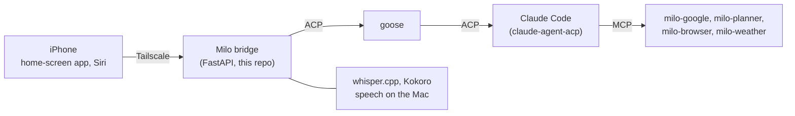

<p align="center">
  
</p>

<h3 align="center">A personal agent on your phone, running on your own Mac</h3>

<p align="center">
<a href="INSTALL.md"><b>Install</b></a> | <a href="docs/FEATURES.md"><b>Features</b></a> | <a href="CLAUDE.md"><b>Dev guide</b></a>
</p>

Milo is an assistant in the style of Meta's Muse. You talk to it from a home-screen app on your iPhone, or through Siri. The work happens on your Mac: Claude Code, driven by goose, with your mail, calendar, files and a browser of its own. Your data stays on the Mac.

- Chat and voice, with speech that runs on the Mac.
- Tasks that continue in the background, with a push alert when they finish.
- An approval card on your phone before Milo sends, deletes or buys anything.
- Memory, goals, scheduled tasks, a to-do list and a planner that keeps to your rules.
- Gmail, Calendar and Drive for several Google accounts, and a browser that you can watch and control.

## How it works



Milo uses [goose](https://github.com/block/goose), [Claude Code](https://claude.com/claude-code) with [claude-agent-acp](https://github.com/agentclientprotocol/claude-agent-acp), [workspace-mcp](https://github.com/taylorwilsdon/google_workspace_mcp), [Playwright MCP](https://github.com/microsoft/playwright-mcp), [whisper.cpp](https://github.com/ggml-org/whisper.cpp), [Kokoro](https://github.com/thewh1teagle/kokoro-onnx), [FastAPI](https://fastapi.tiangolo.com) and [Tailscale](https://tailscale.com).

## Get started

```sh
brew install uv node block-goose-cli whisper-cpp ffmpeg
git clone https://github.com/YOUR_GITHUB_USER/milo ~/Documents/Milo/milo
cd ~/Documents/Milo/milo && ./start.sh
```

You also need a Claude Pro or Max plan, Claude Code, claude-agent-acp and Tailscale. [INSTALL.md](INSTALL.md) has all the steps.

## Private files

Git ignores the files that hold personal data:

- `data/`: config, access token, chats, memory and Google tokens. `./start.sh` makes it. Optional: set `busy_url` in `data/config.json` to a JSON feed of your work meetings (`{"days": {"YYYY-MM-DD": [[start_minute, end_minute]]}}`).
- `BEHAVIOR.md`: your log of behavior issues. Start it with `cp BEHAVIOR.example.md BEHAVIOR.md`.
- `CLAUDE.local.md` and `local/`: notes for your own machine.

## Tests

```sh
uv run pytest -m "not agent"        # unit, API and browser tests
uv run python tests/live/run.py     # live behavior suite (uses your Claude plan)
```
