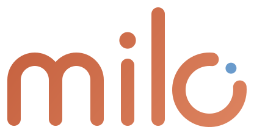
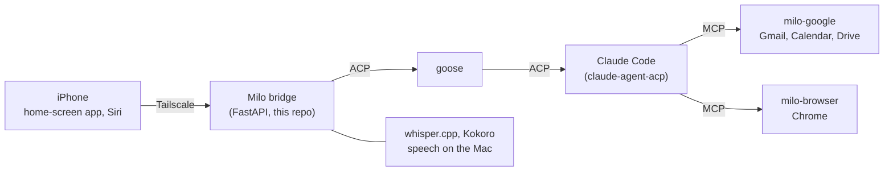

<p align="center">
  
</p>
<p align="center">
  <picture>
    <source media="(prefers-color-scheme: dark)" srcset="web/mark-dark.svg">
    
  </picture>
</p>

<h3 align="center">A personal agent on your phone, running on your own Mac</h3>

<p align="center">
| <a href="INSTALL.md"><b>Install</b></a> | <a href="docs/FEATURES.md"><b>Features</b></a> | <a href="CLAUDE.md"><b>Dev guide</b></a> |
</p>

<p align="center">
  
  
  
  
  
</p>

---

## About

Milo is a Muse-style assistant. You talk to it from a home-screen app on your iPhone, or through Siri. The work happens on your Mac: Claude Code, driven by goose, with your mail, calendar, files and a browser of its own. Your data stays on the Mac.

- **Chat and voice.** Type, hold to talk, or use hands-free voice mode. Speech runs locally.
- **Real work in the background.** Tasks go on after you close the app. You get a push alert when they finish.
- **Approvals.** Before Milo sends, deletes or buys anything, your phone asks: *Allow once*, *Always*, or *Deny*.
- **Memory and goals.** Milo remembers what you tell it and tracks your goals in every chat.
- **Recurring tasks and a to-do list.** "Every weekday at 8, brief me on my calendar and email." "Remind me to call the dentist on Friday" goes on your to-do list, and a daily alert lists what is due.
- **Gmail, Calendar and Drive.** For several Google accounts.
- **Its own browser.** Watch it from the phone, take control, and hand it back. Passwords stay in the Keychain.
- **Feed.** A short brief of your X timelines, with the top posts.

## How it works



## Built on

| | |
|---|---|
| [goose](https://github.com/block/goose) | Agent runtime. Milo talks to it over the [Agent Client Protocol](https://agentclientprotocol.com). |
| [Claude Code](https://claude.com/claude-code) + [claude-agent-acp](https://github.com/agentclientprotocol/claude-agent-acp) | The model and its tools, through your Claude plan. |
| [workspace-mcp](https://github.com/taylorwilsdon/google_workspace_mcp) | Gmail, Calendar and Drive over MCP. |
| [Playwright MCP](https://github.com/microsoft/playwright-mcp) | Milo's browser. |
| [whisper.cpp](https://github.com/ggml-org/whisper.cpp), [Kokoro](https://github.com/thewh1teagle/kokoro-onnx) | Speech to text and text to speech, on the Mac. |
| [FastAPI](https://fastapi.tiangolo.com), [three.js](https://threejs.org), [PDF.js](https://mozilla.github.io/pdf.js/), [Tailscale](https://tailscale.com) | Bridge, the 3D Milo, the file viewer, and private access from your phone. |

## Get started

```sh
brew install uv node block-goose-cli whisper-cpp ffmpeg
git clone https://github.com/YOUR_GITHUB_USER/milo ~/Documents/Milo/milo
cd ~/Documents/Milo/milo && ./start.sh
```

You also need a Claude Pro or Max plan, Claude Code, claude-agent-acp and Tailscale. [INSTALL.md](INSTALL.md) has every step, from the first start to the phone.

## Private files

Some files hold personal data. Git ignores them. The repository has a template or a setup step for each one.

| Private file | Template | How to make it |
|---|---|---|
| `BEHAVIOR.md` | `BEHAVIOR.example.md` | Run `cp BEHAVIOR.example.md BEHAVIOR.md`, then add your own entries to the log. |
| `data/config.json` | none | `./start.sh` makes it at the first start. Add the optional keys below by hand. |
| `data/private.json` | none | Optional. A JSON list of `[real, fake]` pairs for the git filter in `private.py`. Then run `python3 private.py install`. |

Optional keys in `data/config.json`:

- `busy_url`: the URL of a JSON feed of your work meetings, in the format `{"days": {"YYYY-MM-DD": [[start_minute, end_minute]]}}`. The planner shows these times as busy. If you do not set it, the planner uses only your Google calendars.

## Tests

```sh
uv run pytest                     # unit and API tests
uv run python tests/live/run.py   # live behavior suite: how Milo the agent acts
```

`data/` holds your chats, memory and tokens. Git ignores it. Never share it.
